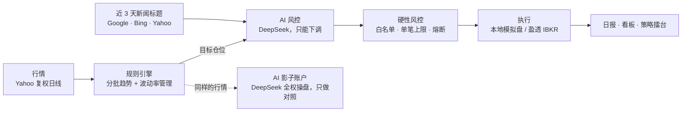

<div align="center">

# Guardian

**只买指数 ETF 的自动投资系统：规则定方向，AI 只能减仓，代码守底线。**

四个风险档位 · 2008 年至今的严格回测 · 每天向前运行的模拟盘

[](https://github.com/gjiaxi05-ctrl/guardian-invest/actions/workflows/tests.yml)
[](LICENSE)
[](#-快速开始)
[](requirements.txt)
[](https://gjiaxi05-ctrl.github.io/guardian-invest/)

[四个档位](#-四个风险档位) · [工作原理](#️-工作原理) · [回测方法](#-回测是怎么做的) · [研究发现](#-研究过程中的发现) · [快速开始](#-快速开始) · [在线看板](https://gjiaxi05-ctrl.github.io/guardian-invest/) · [研究日志](docs/research-log.md) · [English](#english)

</div>

> [!WARNING]
> 这是一个学习和研究用的开源项目，**不是投资建议**。下面所有收益数字都来自历史回测或几周的模拟盘，不代表未来。
> 两倍杠杆 ETF 在震荡和长期下跌中会有额外损耗。如果要用真钱，先用模拟盘跑足够久，只投入你能承受损失的资金。

## 🧭 这是什么

一个每天美股收盘后自动运行一次的投资程序，只交易标普 500、纳斯达克 100 的指数 ETF（以及它们的两倍版本）和短期美债。
它想回答的问题是：**能不能用公开、可检验的规则，在少亏很多的前提下拿到接近甚至超过指数的收益？**

整个系统建立在两条设计原则上：

1. **只买指数 ETF，不碰个股和加密货币。** 标的少而透明，每条规则都能拿 2008 年以来的数据回测。
2. **AI（DeepSeek）只能减仓，不能加仓。** 大模型训练时已经"见过"历史行情，它的判断没法做公平的回测，
   所以它的权力被限制在"最坏也只是比规则更保守"。AI 能不能做得更好，交给一个独立的影子账户向前验证。

## 📊 四个风险档位

四档用的是**同一套机制**（50% 分批月度趋势 + 50% 波动率管理，见下文），只是旋钮拧到不同位置：

| 档位 | 年化收益 | 最大回撤 | 最差 12 个月 | 12 个月亏钱概率 | 2008 年 | 2022 年 | 平均股票仓位 | 用到两倍 ETF |
|---|---:|---:|---:|---:|---:|---:|---:|:---:|
| 🟢 **稳健** `conservative` | 6.5% | -15.0% | -12.3% | 17% | -8.7% | -11.5% | 0.48 倍 | 否 |
| 🟣 **平衡** `balanced` | 10.4% | -21.4% | -16.3% | 18% | -14.7% | -15.1% | 0.78 倍 | 否 |
| 🔵 **成长** `growth` | 14.2% | -31.6% | -22.2% | 21% | -18.6% | -20.8% | 1.26 倍 | 是 |
| 🟠 **激进** `aggressive` | 16.4% | -40.8% | -29.9% | 22% | -27.0% | -28.2% | 1.53 倍 | 是 |
| ⚪ 对照：一直满仓标普 500 | 11.0% | -51.9% | -47.4% | 13% | -36.2% | -18.2% | 1.00 倍 | — |

<sub>2008-01-02 至 2026-11-16，日线回测，收盘后决策、下一个交易日开盘价成交，每笔 0.35 美元佣金 + 0.05% 滑点，偏离目标 10% 以上才交易。
用 `python3 backtest_flex.py --levels --split` 可以复现，并分 2008–2016、2017 至今两段看。</sub>

**怎么读这张表：**

- **平衡档**的收益和满仓标普差不多（10.4% vs 11.0%），最大回撤不到一半（-21% vs -52%）。这是这套方法最核心的价值。
- **成长档、激进档**用两倍 ETF 换更高收益，回撤也跟着变大。激进档历史上跌过 41%，要确定自己拿得住再选。
- **策略不是每年都赢**。牛市里它经常跑输满仓（2025 年各档 4%～11%，标普 17.7%）；2022 年那种慢熊，
  成长档和激进档反而比标普亏得多，因为两倍 ETF 在下跌途中还没来得及完全退出。它防的是 2008 年那种大崩盘，
  代价是常年付一点"保险费"。
- **12 个月亏钱概率**比满仓还高一点：它用"更常小亏"换"很少大亏"。

| 档位 | 参数（`strategies_daily.py` 里的 `RISK_LEVELS`） |
|---|---|
| 稳健 | 平衡档 × 60%，另外 40% 常年放短债 |
| 平衡 | 趋势在时只买普通 ETF；波动率目标 15%，最多满仓 |
| 成长 | 趋势在时一半买两倍 ETF；波动率目标 20%，最高 2 倍档位 |
| 激进 | 趋势在时全部买两倍 ETF；波动率目标 25%，最高 2 倍档位 |

参数是事先按"风险一档比一档高"定的，没有在回测里挑最好看的组合。唯一一次看了结果再修改的是稳健档，原因写在[研究日志](docs/research-log.md)里。

## ⚙️ 工作原理



**1. 规则引擎：方向慢判断，仓位快调整**

- **分批月度趋势（50%）**：标普、纳指的价格在 10 个月均线上方就持有，否则换成短期美债 BIL。
  只在月末判断一次的话，结果非常依赖那一天的运气（换个判断日，历史最大回撤能从 -33% 变成 -47%），
  所以分成 4 批，分别在月末和每月第 5、10、15 个交易日判断，各管四分之一。
- **波动率管理（50%）**：每天看标普/纳指组合最近 20 天的波动率，仓位 = 目标波动 ÷ 实际波动
  （Moreira & Muir, 2017）。市场越平静越敢加仓，波动一放大立刻减仓。

**2. AI 风控（可选）**：每天把规则方案、行情摘要和近 3 天约 130 条新闻标题交给 DeepSeek，
它只能输出"某个资产的上限降到 X"，代码强制只减不加，被减掉的部分进短债。
它只应该对规则看不到的风险出手（ETF 清盘、交易所故障、突发战争等），不因为"估值高""新闻偏空"减仓。
每次调用的完整请求、回答和思考过程都存档在 `state/ai_log/`。没有 API key 或调用失败时，系统自动按纯规则运行。

**3. 硬性风控（AI 和规则都绕不过去）**

- 白名单：只能买指数、债券、商品 ETF 和两只两倍 ETF（SSO、QLD）；个股、三倍、反向 ETF 写进配置也会被剔除
- 单笔最多占净值 35%，每天最多 12 笔，偏离目标不到 10% 不交易
- 回撤熔断：距最高点跌超 35%，风险资产砍半，回撤收窄到一半以内才恢复
- 数据体检：行情超过 4 天没更新、或单日涨跌超过 25%（疑似坏数据），当天停止交易
- 配置守门（`config_guard.py`）：每个参数都有不可突破的范围，写错的值自动换成更安全的那个
- 真钱模式必须在配置里写一句确认口令并设置最多动用的资金，否则强制只读
- 急停：项目目录里放一个 `STOP` 文件，系统什么都不做

**4. 向前验证**：除了主账户，系统每天还同时运行一个 AI 影子账户（DeepSeek 全权决定仓位）和一个"策略擂台"
（四个档位和几种研究过的策略各开一个虚拟账户），全部按真实的下一个开盘价成交，用没见过的未来检验回测。

## 🔬 回测是怎么做的

回测最容易骗自己，所以这几条是刻意做的：

- **没有未来函数**：每天收盘后只用当天及以前的数据决策，**下一个交易日开盘价**成交，不是用决策当天的收盘价。
  单元测试里有一条专门检查：把今天之后的行情全部改掉，今天的仓位不能变。
- **算上成本**：每笔 0.35 美元佣金 + 0.05% 滑点，偏离目标 10% 以上才交易（和模拟盘设置一致）。
- **回测和实盘共用同一套策略代码**（`strategies_daily.py`），不是两份各写各的。
- **分段检查**：2008–2016 和 2017 至今分开统计，避免只在某一段好看。四个档位在两段里排序一致。
- **参数用文献里的常用值**（10 个月均线、20 日波动率），没有为回测好看去调。

**仍然存在的局限**：

- 只有约 19 年数据，真正的大熊市只有 2008、2020、2022 三次，样本很少。
- 两倍 ETF（SSO 2006 年、QLD 2006 年上市）没有经历过 1970 年代滞胀、2000 年科技泡沫破裂这类更长的下跌。
- 开盘价成交假设对小资金合理，大资金会有更大的冲击成本。
- 研究过程中比较过十几种策略，最后选中的方案难免有"选择偏差"，真实表现大概率比回测差一些。

## 🧪 研究过程中的发现

完整过程在[研究日志](docs/research-log.md)里，几条最有意思的：

- **趋势策略的"保险费"是真实的。** 2008 年以来标普跌破均线卖出 15 次，其中 14 次之后以更高的价格买回（平均多付 6.8%）；
  纳指 16 次里有 14 次（平均多付 7.7%）。它的价值全部来自少数几次躲过大跌（2008 年少亏 23.8 个百分点）。
- **判断日期的运气比想象中大。** 同一个策略只是把每月判断日从月末换到月初第 1 个交易日，历史最大回撤从 -33% 变成 -47%。
  这直接促成了"分 4 批判断"的设计。
- **加缓冲带反而更差。** "跌破均线 2～3% 才卖"听起来能减少来回打脸，实际上急跌时退得更晚，2020 年回撤恶化到 -44%。
- **很多"领先指标"在 2022 年失灵了。** VIX 期限结构、高收益债信用利差这类信号能躲开恐慌式暴跌，
  但在 2022 年加息导致的慢熊里分别亏了 48% 和 60%。
- **小账户最大的敌人是佣金。** 每笔 1 美元时，天天交易的策略每年被成本吃掉 7～9 个百分点，所以整个系统都在控制换手。

## 🧾 向前实测（模拟盘）

成长档主账户自 2026-10-23 起用 4,200 美元虚拟本金、只买整股、按真实开盘价成交。截至 2026-11-17 收盘：

| 账户 | 收益 |
|---|---:|
| 主账户（成长档 + AI 风控） | -3.21% |
| 对照：满仓标普 500 | -4.13% |
| 对照：60% 股票 / 40% 债券 | -2.82% |

才四周，**说明不了任何问题**。至少要跑 6 个月、经历一次信号切换，才能和回测对照。
每天的最新净值、AI 影子账户和擂台排名在[在线看板](https://gjiaxi05-ctrl.github.io/guardian-invest/)。

## 🚀 快速开始

只需要 Python 3.9 以上，不用安装任何第三方库（连接盈透证券时才需要 `ib_async`）。

```bash
git clone https://github.com/gjiaxi05-ctrl/guardian-invest.git
cd guardian-invest

python3 -m unittest discover -s tests       # 离线测试，几秒钟
python3 backtest_flex.py --levels --split   # 首次会下载 2008 年至今的行情（约 1 分钟），然后回测四个档位
python3 dashboard.py                        # 生成看板 reports/dashboard.html，用浏览器打开
```

选一个档位跑本地模拟盘（个人设置写在 `config.local.json`，它会覆盖 `config.json`，并且不会被 git 提交）：

```bash
echo '{"risk_level": "balanced"}' > config.local.json
python3 run.py          # 每个交易日收盘后运行一次；日报在 reports/，账户状态在 state/
```

可选：

- **AI 风控**：把 DeepSeek API key 放进环境变量 `DEEPSEEK_API_KEY`（macOS 也可以存进钥匙串：`security add-generic-password -s guardian-deepseek -a guardian -w`）。
  每天约 0.2～0.4 元人民币。没有 key 时系统按纯规则运行。
- **Telegram 推送**：设置 `TELEGRAM_BOT_TOKEN` 和 `TELEGRAM_CHAT_ID`。
- **定时运行**：macOS 用 [`deploy/com.guardian-invest.daily.plist.example`](deploy/com.guardian-invest.daily.plist.example)；Linux 用 cron 调用 `run_daily.sh`。
- **接盈透证券（IBKR）**：把 `mode` 改成 `ibkr_paper`，打开 IB Gateway 的 API（端口 4002）。注意 IBKR Lite 账户不能用 API，需要 IBKR Pro。
  API 不支持零股，所以下单时 SPY→SPYM、QQQ→QQQM（同指数、单价更低）。

## 🗂️ 项目结构

| 文件 | 作用 |
|---|---|
| `strategies_daily.py` | 按日策略和**四个风险档位**，回测和实盘共用 |
| `strategies.py` | 月度策略库（Faber、Keller HAA、双动量等），研究和对照用 |
| `backtest_flex.py` | 日线回测引擎：次日开盘成交、含成本、分段统计 |
| `run.py` | 每日主流程：急停 → 数据体检 → 熔断 → 规则目标 → AI 复核 → 硬性风控 → 成交 → 日报 |
| `ai_review.py` | DeepSeek 风控复核和新闻抓取，代码强制只减不加，完整留档 |
| `shadow.py` | AI 影子账户：DeepSeek 全权操盘的对照实验 |
| `config_guard.py` | 配置守门：参数上下限、白名单、档位展开、真钱模式确认 |
| `broker.py` | 本地模拟盘（次日开盘价结算）和盈透证券接口 |
| `dashboard.py` | 生成看板网页 |
| `tests/` | 离线单元测试 |
| `docs/research-log.md` | 研究日志：每次改策略的原因和被推翻的结论 |

## 📚 参考文献

- Moreira, A. & Muir, T. (2017). *Volatility-Managed Portfolios*. Journal of Finance.
- Faber, M. (2007). *A Quantitative Approach to Tactical Asset Allocation*.
- Keller, W. & Keuning, J. (2023). *Dual and Canary Momentum with Rising Yields/Inflation: Hybrid Asset Allocation (HAA)*.
- Antonacci, G. (2014). *Dual Momentum Investing*.

## ⚖️ 免责声明

本项目仅用于学习和研究。作者不是持牌投资顾问，项目中的任何内容都不构成投资建议或买卖任何证券的推荐。
历史回测有其局限，过去的表现不代表未来收益。使用本项目进行真实交易的一切风险和后果由使用者自行承担。

---

## English

**Guardian** is an automated investing system that trades only index ETFs (S&P 500, Nasdaq-100, their 2x versions, and short-term Treasuries).
Rules set the direction, an LLM (DeepSeek) may only *reduce* risk, and hard-coded guardrails have the final say.
Two deliberate design choices:
no single stocks or crypto, and the AI can never add risk, because an LLM's judgement cannot be fairly backtested (it has seen historical prices during training).

**Four risk levels, one mechanism.** Every level is 50% *tranched monthly trend* (10-month moving average checked in four tranches per month to remove check-day luck)
plus 50% *volatility management* (exposure = target vol ÷ realised 20-day vol, Moreira & Muir 2017). Only four parameters change between levels.

| Level | CAGR | Max drawdown | Worst 12 months | 2008 | 2022 |
|---|---:|---:|---:|---:|---:|
| Conservative | 6.5% | -15.0% | -12.3% | -8.7% | -11.5% |
| Balanced | 10.4% | -21.4% | -16.3% | -14.7% | -15.1% |
| Growth | 14.2% | -31.6% | -22.2% | -18.6% | -20.8% |
| Aggressive | 16.4% | -40.8% | -29.9% | -27.0% | -28.2% |
| Buy & hold SPY | 11.0% | -51.9% | -47.4% | -36.2% | -18.2% |

<sub>Daily backtest 2008-01 to 2026-11, decisions after the close, fills at the next open, $0.35 per order + 5 bp slippage, 10% rebalance band.</sub>

**Backtest hygiene.** No look-ahead (a unit test rewrites all future prices and checks today's target is unchanged);
next-open fills and costs; the same strategy code runs in the backtest and in live paper trading; results are reported for 2008–2016 and 2017–today separately.
**Known limits:** only ~19 years of data and three real bear markets; 2x ETFs have never lived through a 1970s- or 2000-style decline; selection bias from comparing many strategies.

**Findings from the research** (see the [research log](docs/research-log.md), in Chinese): trend-following exits were bought back higher 14 out of 15 times on the S&P 500, so the strategy is effectively paying an insurance premium for rare crash protection;
moving the monthly check day alone changed historical max drawdown from -33% to -47%, which motivated the four-tranche design;
VIX term-structure and credit-spread "canaries" failed badly in the slow 2022 bear market; and per-order commissions dominate small accounts.

**Quick start:** Python 3.9+, no dependencies. `python3 -m unittest discover -s tests`, then `python3 backtest_flex.py --levels --split`, then `python3 dashboard.py`.
Choose a level with `echo '{"risk_level": "balanced"}' > config.local.json` and run `python3 run.py` once per trading day for local paper trading.

**Disclaimer:** for education and research only. Not investment advice. Past performance does not guarantee future results.
