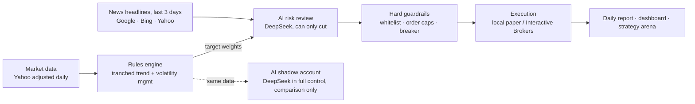

<div align="center">

# Guardian

**An automated investing system that only buys index ETFs: rules set the course, AI can only cut risk, code holds the line.**

Four risk levels · Strict daily backtests since 2008 · Paper trading that runs forward every day

[](https://github.com/gjiaxi05-ctrl/guardian-invest/actions/workflows/tests.yml)
[](LICENSE)
[](#-quick-start)
[](requirements.txt)
[](https://gjiaxi05-ctrl.github.io/guardian-invest/)

[Risk levels](#-four-risk-levels) · [How it works](#️-how-it-works) · [Backtest method](#-how-the-backtest-was-done) · [Findings](#-what-the-research-found) · [Quick start](#-quick-start) · [Live dashboard](https://gjiaxi05-ctrl.github.io/guardian-invest/) · [Research log](docs/research-log.md) · **English** · [中文](README.zh-CN.md)

</div>

> [!WARNING]
> This is an open-source project for learning and research, **not investment advice**. Every return figure below comes from historical backtests or a few weeks of paper trading and says nothing certain about the future.
> 2x leveraged ETFs lose extra value in choppy and long-falling markets. If you ever use real money, run the paper account for a long time first and only invest what you can afford to lose.

## 🧭 What this is

A program that runs once a day after the US market closes and trades only index ETFs on the S&P 500 and Nasdaq-100 (plus their 2x versions) and short-term US Treasuries.
The question it tries to answer: **can public, testable rules earn returns close to, or above, the index while losing much less in crashes?**

The architecture is inspired by the open-source project [BinanceClaw](https://github.com/TypeThe0ry/BinanceClaw) (AI manages a crypto account while code enforces risk limits), with two deliberate changes:

1. **Index ETFs only, no single stocks or crypto.** A small, transparent universe means every rule can be backtested on data going back to 2008.
2. **The AI (DeepSeek) can only reduce positions, never add.** A large language model has already "seen" historical prices during training, so its judgement cannot be backtested fairly.
   Its power is therefore limited so that, at worst, it makes the portfolio more conservative than the rules. Whether the AI can do better is tested forward in a separate shadow account.

## 📊 Four risk levels

All four levels use **the same mechanism** (50% tranched monthly trend + 50% volatility management, explained below); only the dial is set differently:

| Level | Annual return | Max drawdown | Worst 12 months | Chance of losing over 12 months | 2008 | 2022 | Avg. stock exposure | Uses 2x ETFs |
|---|---:|---:|---:|---:|---:|---:|---:|:---:|
| 🟢 **Conservative** `conservative` | 6.5% | -15.0% | -12.3% | 17% | -8.7% | -11.5% | 0.48x | No |
| 🟣 **Balanced** `balanced` | 10.4% | -21.4% | -16.3% | 18% | -14.7% | -15.1% | 0.78x | No |
| 🔵 **Growth** `growth` | 14.2% | -31.6% | -22.2% | 21% | -18.6% | -20.8% | 1.26x | Yes |
| 🟠 **Aggressive** `aggressive` | 16.4% | -40.8% | -29.9% | 22% | -27.0% | -28.2% | 1.53x | Yes |
| ⚪ Benchmark: always 100% S&P 500 | 11.0% | -51.9% | -47.4% | 13% | -36.2% | -18.2% | 1.00x | — |

<sub>2008-01-02 to 2026-11-16, daily backtest: decide after the close, fill at the next trading day's open, $0.35 commission per order + 0.05% slippage, trade only when a holding drifts more than 10% from target.
Reproduce with `python3 backtest_flex.py --levels --split`, which also reports 2008–2016 and 2017–today separately.</sub>

**How to read this table:**

- **Balanced** earns about the same as holding the S&P 500 (10.4% vs 11.0%) with less than half the maximum drawdown (-21% vs -52%). That is the core value of the approach.
- **Growth** and **Aggressive** use 2x ETFs for higher returns, and their drawdowns grow too. Aggressive has fallen 41% in the past; pick it only if you are sure you could hold through that.
- **The strategy does not win every year.** In bull markets it often lags full investment (all levels returned 4%–11% in 2025, the S&P 500 17.7%).
  In a slow bear market like 2022, Growth and Aggressive actually lost more than the S&P 500, because the 2x ETFs did not get out in time on the way down.
  What it protects against is a 2008-style crash, and the price is a small "insurance premium" paid most of the time.
- **The chance of losing money over 12 months** is slightly *higher* than holding the index: the strategy trades "small losses more often" for "big losses rarely".

| Level | Parameters (`RISK_LEVELS` in `strategies_daily.py`) |
|---|---|
| Conservative | 60% of Balanced, the other 40% always in short-term Treasuries |
| Balanced | Ordinary ETFs only when the trend is up; volatility target 15%, at most fully invested |
| Growth | Half in 2x ETFs when the trend is up; volatility target 20%, up to 2x exposure |
| Aggressive | All in 2x ETFs when the trend is up; volatility target 25%, up to 2x exposure |

The parameters were fixed in advance so that risk rises from one level to the next; no combination was picked for its backtest results.
The one time a level was changed after seeing results was Conservative, and the reason is recorded in the [research log](docs/research-log.md).

## ⚙️ How it works



**1. Rules engine: slow on direction, fast on position size**

- **Tranched monthly trend (50%)**: hold the S&P 500 or Nasdaq-100 while its price is above its 10-month moving average, otherwise switch to short-term Treasuries (BIL).
  Checking only once at month-end makes results depend heavily on the luck of that single day (moving the check day changed the historical max drawdown from -33% to -47%),
  so the decision is split into four tranches, checked at month-end and on the 5th, 10th and 15th trading day of each month, each controlling a quarter.
- **Volatility management (50%)**: every day, look at the 20-day volatility of a 50/50 S&P 500 / Nasdaq-100 basket and set exposure = target volatility ÷ actual volatility
  (Moreira & Muir, 2017). The calmer the market, the more it invests; as soon as volatility jumps, it cuts back.

**2. AI risk review (optional)**: each day DeepSeek receives the rules' target, a market summary and about 130 news headlines from the last three days.
It may only output "lower the cap on asset X to Y"; the code enforces reduce-only, and anything cut goes into short-term Treasuries.
It is instructed to act only on risks the rules cannot see (an ETF closing, an exchange outage, sudden war, and so on), never on "valuations look high" or "the news is negative".
The full request, answer and reasoning of every call are archived in `state/ai_log/`. Without an API key, or if the call fails, the system simply follows the rules.

**3. Hard guardrails (neither the AI nor the rules can bypass them)**

- Whitelist: only index, bond and commodity ETFs plus two 2x ETFs (SSO, QLD); single stocks, 3x and inverse ETFs are removed even if written into the config
- Each order at most 35% of the account; at most 12 orders a day; no trade unless a holding is more than 10% off target
- Drawdown breaker: if the account falls more than 35% from its peak, risky assets are cut in half until the drawdown recovers to less than half of that
- Data checks: if prices have not updated for more than 4 days, or any ETF moves more than 25% in a day (likely bad data), no trading that day
- Config guard (`config_guard.py`): every parameter has hard limits, and invalid values are replaced with the safer option
- Real-money mode requires a written confirmation phrase in the config and a maximum amount of capital, otherwise the connection is forced read-only
- Emergency stop: put a file named `STOP` in the project folder and the system does nothing

**4. Forward testing**: next to the main account, the system runs an AI shadow account every day (DeepSeek decides all positions) and a "strategy arena"
(one virtual account each for the four levels and several other strategies studied), all filled at the real next-day open, to test the backtests against a future they have never seen.

## 🔬 How the backtest was done

Backtests are the easiest place to fool yourself, so these choices were deliberate:

- **No look-ahead**: each decision uses only data up to that day's close and is filled at the **next trading day's open**, not at the close of the decision day.
  A unit test checks this directly: it rewrites every price after a given day and verifies that day's target does not change.
- **Costs included**: $0.35 per order plus 0.05% slippage, trading only when a holding drifts more than 10% from target (the same as the paper account).
- **The backtest and the live system share the same strategy code** (`strategies_daily.py`) instead of two separate implementations.
- **Split-sample check**: 2008–2016 and 2017–today are reported separately so a strategy cannot look good only in one period. The four levels rank in the same order in both halves.
- **Parameters are standard values from the literature** (10-month moving average, 20-day volatility), not tuned to make the backtest look good.

**Limitations that remain:**

- Only about 19 years of data, with just three real bear markets (2008, 2020, 2022).
- The 2x ETFs (SSO and QLD, both launched in 2006) have never lived through a long decline like 1970s stagflation or the 2000 dot-com crash.
- Filling at the open is realistic for small accounts; large accounts would face higher market-impact costs.
- More than a dozen strategies were compared during research, so the chosen one carries some selection bias; real results will most likely be somewhat worse than the backtest.

## 🧪 What the research found

The full story is in the [research log](docs/research-log.md). A few of the most interesting findings:

- **The "insurance premium" of trend following is real.** Since 2008 the S&P 500 dropped below its moving average and triggered a sale 15 times; 14 of those times it was bought back later at a higher price (6.8% higher on average).
  For the Nasdaq-100 it was 14 out of 16 (7.7% higher on average). All of the value comes from the few times it avoided a big crash (in 2008 it lost 23.8 percentage points less).
- **Check-day luck is bigger than expected.** Moving the monthly check from the last trading day to the first trading day of the month changed the historical max drawdown of the same strategy from -33% to -47%.
  This led directly to the four-tranche design.
- **Buffer bands made things worse.** "Only sell after the price falls 2–3% below the average" sounds like a way to avoid whipsaws, but in fast crashes it exits later; the 2020 drawdown worsened to -44%.
- **Many "leading indicators" failed in 2022.** Signals based on the VIX term structure or high-yield credit spreads avoid panic crashes,
  but in the slow, rate-hike-driven bear market of 2022 they lost 48% and 60% respectively.
- **For a small account, commissions are the biggest enemy.** At $1 per order, strategies that trade daily lose 7–9 percentage points a year to costs, so the whole system is built to limit turnover.

## 🧾 Forward results (paper trading)

The main account (Growth level) has run since 2026-10-23 with $4,200 of virtual capital, whole shares only, filled at real opening prices. As of the 2026-11-17 close:

| Account | Return |
|---|---:|
| Main account (Growth + AI risk review) | -3.21% |
| Benchmark: 100% S&P 500 | -4.13% |
| Benchmark: 60% stocks / 40% bonds | -2.82% |

Four weeks of data **prove nothing**. At least six months and one signal change are needed before comparing with the backtest.
The latest daily values, the AI shadow account and the arena ranking are on the [live dashboard](https://gjiaxi05-ctrl.github.io/guardian-invest/).

## 🚀 Quick start

All you need is Python 3.9 or later; there is nothing to install (`ib_async` is only needed to connect to Interactive Brokers).

```bash
git clone https://github.com/gjiaxi05-ctrl/guardian-invest.git
cd guardian-invest

python3 -m unittest discover -s tests       # offline tests, a few seconds
python3 backtest_flex.py --levels --split   # first run downloads prices since 2008 (about a minute), then backtests the four levels
python3 dashboard.py                        # builds the dashboard at reports/dashboard.html; open it in a browser
```

Pick a level and run the local paper account (personal settings go in `config.local.json`, which overrides `config.json` and is never committed to git):

```bash
echo '{"risk_level": "balanced"}' > config.local.json
python3 run.py          # run once after each US trading day; reports go to reports/, account state to state/
```

Optional:

- **AI risk review**: put a DeepSeek API key in the environment variable `DEEPSEEK_API_KEY` (on macOS it can also live in the Keychain: `security add-generic-password -s guardian-deepseek -a guardian -w`).
  It costs about 0.2–0.4 RMB a day. Without a key the system runs on rules alone.
- **Telegram notifications**: set `TELEGRAM_BOT_TOKEN` and `TELEGRAM_CHAT_ID`.
- **Scheduling**: on macOS use [`deploy/com.guardian-invest.daily.plist.example`](deploy/com.guardian-invest.daily.plist.example); on Linux call `run_daily.sh` from cron.
- **Interactive Brokers (IBKR)**: set `mode` to `ibkr_paper` and enable the API in IB Gateway (port 4002). Note that IBKR Lite accounts cannot use the API; IBKR Pro is required.
  The API does not support fractional shares, so orders use SPYM instead of SPY and QQQM instead of QQQ (same index, lower share price).

Code comments and daily reports are written in Chinese; the dashboard has an English / 中文 switch.

## 🗂️ Project structure

| File | Purpose |
|---|---|
| `strategies_daily.py` | Daily strategies and the **four risk levels**, shared by backtest and live runs |
| `strategies.py` | Library of monthly strategies (Faber, Keller HAA, dual momentum, etc.) used for research and comparison |
| `backtest_flex.py` | Daily backtest engine: next-open fills, costs, split-sample statistics |
| `run.py` | Daily pipeline: emergency stop → data checks → breaker → rules target → AI review → hard guardrails → orders → report |
| `ai_review.py` | DeepSeek risk review and news collection; reduce-only enforced in code; every call archived |
| `shadow.py` | AI shadow account: a comparison experiment where DeepSeek has full control |
| `config_guard.py` | Config guard: parameter limits, whitelist, risk-level expansion, real-money confirmation |
| `broker.py` | Local paper broker (settles at the next open) and Interactive Brokers adapter |
| `dashboard.py` | Builds the dashboard web page |
| `tests/` | Offline unit tests |
| `docs/research-log.md` | Research log: why each change was made and which conclusions were overturned ([中文版](docs/research-log.zh-CN.md)) |

## 🙏 Acknowledgements and references

- [BinanceClaw](https://github.com/TypeThe0ry/BinanceClaw): inspiration for the architecture (AI proposes, code enforces, hard limits on every setting)
- Moreira, A. & Muir, T. (2017). *Volatility-Managed Portfolios*. Journal of Finance.
- Faber, M. (2007). *A Quantitative Approach to Tactical Asset Allocation*.
- Keller, W. & Keuning, J. (2023). *Dual and Canary Momentum with Rising Yields/Inflation: Hybrid Asset Allocation (HAA)*.
- Antonacci, G. (2014). *Dual Momentum Investing*.

## ⚖️ Disclaimer

This project is for learning and research only. The author is not a licensed investment adviser, and nothing in this project is investment advice or a recommendation to buy or sell any security.
Historical backtests have limitations, and past performance does not guarantee future results. Anyone using this project for real trading does so entirely at their own risk.
